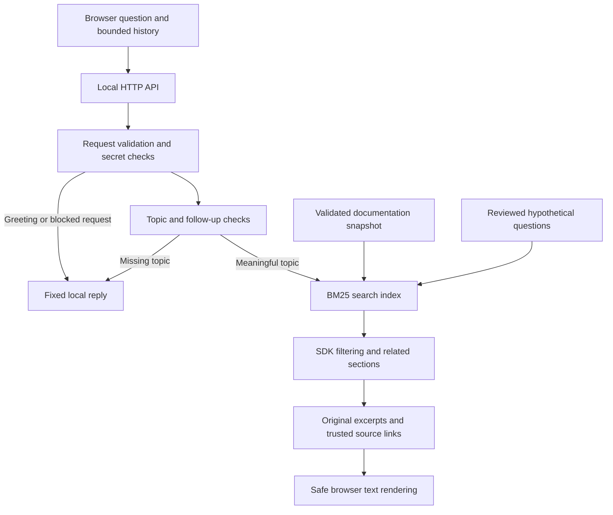

# Architecture

Documentation and index structures are created at startup and read during requests. Each request has its own query, selected sections and output. No server component stores conversation history. Browser memory is owned by one ChatMemory instance; a version counter and AbortController prevent late results appearing after Close or New chat.

The index uses term frequency, positive inverse-document frequency, and section-length normalization with k1=1.2 and b=0.75. Titles receive additional weight. Hypothetical questions provide additional matching vocabulary but never change original source text. SDK selection comes from user messages only. The latest independent user topic anchors ambiguous follow-ups. This is a heuristic, not semantic understanding.

The API exposes GET /api/status, POST /api/chat and four allowlisted UI assets. Private files and data exports are not served. Search requests require JSON, an allowed loopback Host and same-origin browser requests. Bodies are capped at 100,000 bytes; rate limiting permits 20 requests per IP per minute. Read timeouts bound stalled request bodies. Query text, source passages and credentials are not logged.

Source URLs must match the approved AgentGuard documentation host and slug. The browser independently checks link origins and renders content with textContent. Sections containing recognizable secret patterns are excluded before indexing. These checks are limited and do not establish semantic accuracy or complete secret detection.

The only automatic networking during app use is the browser talking to its local server. Opening a source link visits the documentation website. Setup can download Python if uv needs it. There is no model or answer-generation stage.

The source corpus is a fixed JSON snapshot. The old application, its virtual environment, provider code, importer and UI code were not copied. Only documentation content and reviewed question mappings were reused. The new .venv was created independently.

## Empty and incomplete questions

The browser disables Search for empty or whitespace-only input and sends no search request. The API separately rejects such requests with HTTP 400. Non-empty filler-only input requests a feature or topic. Vague actions and pronouns return status clarification with no sources unless a recent user message supplies a subject. Assistant suggestions never select a subject or SDK. Short topic phrases can complete a prior missing-topic question; explicit new subjects replace earlier SDK context. SDK and language names remain indexed so short phrases are searchable. These lexical rules do not determine semantic answerability, and BM25 may still return loosely related results.

A no-match response describes the search failure (could not find a relevant section), without asserting that the documentation lacks the answer. All clarification handling is request-local, uses the same bounded browser history, and performs no model calls or external search.
